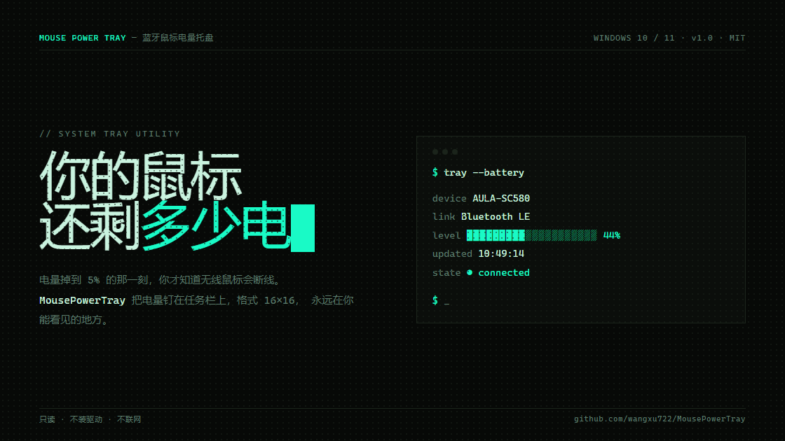

# MousePowerTray · 蓝牙鼠标电量托盘



给 Windows 任务栏加一个**蓝牙鼠标电量图标**。双击就用，零配置、零依赖、免编译。
支持任何实现了标准 BLE 电池服务的输入设备。

> 只读、不装驱动、不联网。只是把 Windows 已经采好的电量画到托盘上。

- 官网 / 宣传页：**https://wangxu722.github.io/MousePowerTray/**
- 下载：[`dist/MousePowerTray.zip`](dist/MousePowerTray.zip)（27.2 KB）

---

## 一个图标就够了

图标是运行时用 GDI+ 现画的，不依赖任何图片素材：竖直胶囊体（鼠标）+ 滚轮 + 按键缝，按电量从下往上填充。


| 颜色 | 含义 |
| --- | --- |
| 青绿 `#19FAC6` | 40% 以上 |
| 黄 `#FFC036` | 16% – 40% |
| 红 `#F0503C` | 15% 及以下，弹一次气泡 |
| 灰 | 断开 / 无设备，仍保留最后读数 |

---

## 快速开始

1. 解压 `MousePowerTray.zip` 到任意目录
2. 双击 **`MousePowerTray.vbs`**（wscript 静默启动，不闪黑窗）
3. 右键托盘 → 勾「开机自动启动」

右键菜单：显示详情 / 选择设备… / 立即刷新 / 开机自动启动 / 打开日志 / 退出。

配置与日志在 `%LOCALAPPDATA%\MousePowerTray\`，不写程序目录。

---

## 原理

两种连接方式走两条完全不同的路，程序会自动识别：

**① 蓝牙 LE（多数情况）**

```
鼠标 ──BLE──▶ GATT 0x180F ──▶ 0x2A19 ──▶ Windows 缓存 ──▶ DEVPKEY_Bluetooth_Battery ──▶ 托盘
              标准电池服务      电量 uint8     系统自己采        只读，无需抓包            GDI+ 现画
```

不逆向任何厂商协议。Windows 自己已经在订阅标准 BLE 电池服务，本工具只把那个数字读出来。

**② 2.4G 接收器（USB 私有协议）**

2.4G 模式下系统完全不知道电量，只能监听接收器的厂商通道（只读，绝不写设备）：

```
接收器 0xFF02 通道 / 33 字节输入报告
  00 D1 <链路 01|00> <电量 0-100> 00 01 11 01 00 …
   │  │  └ 0=待机 1=活跃   └ 实测 0x29 = 41%，与蓝牙读数一致
   │  └ 电量/状态帧（D2 是另一种帧，与本工具无关）
   └ Report ID
```

接收器**只在状态变化时上报**（开机、唤醒、电量变化），不是周期性推送，
所以判离线只能靠"多久没收到帧"（180 秒），链路标志 0 只当"待机"处理 —— 实测它会在空闲时来回跳。

> 换别的 2.4G 鼠标需要改 `config.json` 里的 `UsbVid` / `UsbPid` / `UsbUsagePage`，
> 帧格式大概率也不一样，这个能力是**按型号适配**的，不像蓝牙那样换牌子就能用。

### 三个工程决定

1. **探测放后台线程。** BLE 侧 `Get-PnpDeviceProperty` 单次 1.1s，放 UI 线程会卡菜单；
   2.4G 侧用独立 .NET 线程阻塞读 HID，帧通过线程安全队列交给 UI，两边都不阻塞消息循环。
2. **图标走内存 ICO（PNG 载荷）。** `Icon.FromHandle` 每换一次图标漏一个 HICON，
   跑几天能耗光 GDI 句柄；用流构造的 `Icon` 在 `Dispose()` 时是真释放。
3. **在线判定用"会长会消失"的信号**：BLE 看 `HID\` 实例是否在场（注意它的 Class 是 Mouse，
   不是 HIDClass）；2.4G 看是否还有帧进来。都不看电量时间戳。

---

## 边界（说清楚做不到什么）

| 支持 | 不支持 |
| --- | --- |
| 标准 BLE 电池服务的输入设备 | **纯经典蓝牙耳机** —— 电量只在 HFP 通道里，不进系统 |
| 鼠标 / 键盘 / 部分手柄，多台可切换 | **手环** —— 私有服务 + 需要 auth key |
| **2.4G 接收器**（已按 AULA 089D:062F 适配） | 其它品牌的 2.4G 接收器 —— 帧格式各不相同，**可以按下面「诊断 → 适配」的流程补** |
| 断开重连自动识别 | |

精度就是 1%（BLE 的 `0x2A19`、2.4G 帧里的电量字节都是 uint8）；刷新节奏由设备上报决定，
所以详情浮层里给了「数据更新」时间 —— 那个数字不变，往往只是电量没变。

**2.4G 的额外说明**：接收器只在事件发生时上报，所以刚启动时可能要先等一次（开关机、按 DPI、
或者正常使用一会儿），期间托盘显示「等待上报」；判定离线要连续 180 秒收不到帧，
比蓝牙模式慢，这是协议决定的，不是卡了。

---

## 别人的鼠标读不到电量，怎么收集信息来适配

先分清一件事：**大部分情况根本不需要适配**。读不到只有四种原因，程序自己能分辨出来，
所以不用让对方在命令行里一项项试。

### 第一步：让他收集一份诊断包

右键托盘 → **「读不到电量？收集诊断信息…」** → 确定。

程序会在桌面生成 `MousePowerTray-诊断-<时间>.zip`，里面只有三样东西：

| 文件 | 内容 |
| --- | --- |
| `诊断报告.txt` | 系统版本、全部 BLE 设备的电量属性、全部 HID 接口清单、自动判定结论 |
| `tray.log` | 最近运行记录 |
| `capture.txt` | 只在走 2.4G 时才有：厂商通道的原始帧 |

不含个人文件，路径里的账户名已打码成 `***`。

如果鼠标是 2.4G 接收器，收集时会额外监听 30 秒，期间需要**关掉鼠标电源、等 3 秒、再打开**，
再按几下 DPI 键 —— 接收器只有事件发生时才说话，不操作就抓不到帧。

### 第二步：看报告里的「自动判定」

| 报告结论 | 含义 | 下一步 |
| --- | --- | --- |
| 蓝牙模式下本来就能用 | 已经读到了 | 不用适配，按报告里的 4 条排查显示问题 |
| 检测到 2.4G 接收器 | 有 USB 厂商通道 | **可适配**，看抓包结果 |
| 是 BLE 设备但没有电池服务 | 设备没实现 0x180F | 无解。可让他重连一次、`Restart-Service bthserv` 后重新收集 |
| 既没蓝牙电量也没厂商通道 | 大概率经典蓝牙或没连上 | 无解 |

### 第三步：2.4G 适配（唯一需要动手的情况）

`诊断报告.txt` 里有「帧格式初判」，关键一步是**按帧类型分组**——同一条通道上常有好几种帧，
字节含义完全不同，混在一起统计会得到一堆假候选：

```
[类型1] 通道 0xFF02  33 字节  首 2 字节 0x00D1  共 4 帧
    [ 2]  0x00..0x01  (  0..  1)  0/1 开关位（连接状态之类）
    [ 3]  0x29..0x29  ( 41.. 41)  固定值（本次没变，仅供参考）
[类型2] 通道 0xFF02  33 字节  首 2 字节 0x00D2  共 1 帧
    只出现 1 次，无法比对：00 D2 26 30 00 00 11 01 ...
```

判读规则：**关掉电源时归零、开机后回到几十的那个字节就是电量**。上面这组是实测的 AULA-
SC580 —— `[2]` 是链路位（关机会跳到 0），`[3]=0x29=41%` 是电量，`0x00D2` 是另一种帧，要排除。

把结论填进 `config.json`（程序目录不管，在 `%LOCALAPPDATA%\MousePowerTray\config.json`）：

```json
"UsbVid": "089D",
"UsbPid": "062F",
"UsbUsagePage": "FF02",
"UsbFrameType": "D1",
"UsbLevelIndex": 3,
"UsbLinkIndex": 2
```

| 字段 | 怎么填 |
| --- | --- |
| `UsbVid` / `UsbPid` | 报告里「厂商通道的设备实例」那行的 VID:PID |
| `UsbUsagePage` | 抓包用的那条通道，如 `FF02` |
| `UsbFrameType` | 帧类型字节，即上面 `0x00D1` 里的 `D1`；留空表示不过滤所有帧 |
| `UsbLevelIndex` | 电量在第几个字节（从 0 数） |
| `UsbLinkIndex` | 链路/待机标志的下标；填 `-1` 表示不区分 |

改完重启程序。**多数接收器到这一步就能用了，不用改代码。**

工具刻意**默认不去碰任何 USB 设备**（`UsbVid` 等默认为空）：读不到电量的情况千奇百怪，
宁可什么都不做，也不要去打开一个不属于自己的接收器。

### 什么时候必须改代码

只有帧结构不是"固定偏移单字节"时才要动 `Update-UsbState`：

- 电量跨两个字节（如 `高字节 << 8 | 低字节`）
- 电量是 0–15 的档位而不是百分比（需要换算）
- 设备不主动上报，必须先往 `out` 通道发一帧查询命令（**这一步带风险，不要盲猜着发**）
- 帧经过加密或校验

这种情况下把 `诊断报告.txt` + `capture.txt` 一起看，先确认能抓到帧、再讨论要不要发命令。

### 命令行等价操作

```powershell
# 只收集（不碰 USB，最安全）
powershell -NoProfile -ExecutionPolicy Bypass -File .\MousePowerTray.ps1 -Diagnose

# 收集 + 抓包 60 秒（会提示操作鼠标）
powershell -NoProfile -ExecutionPolicy Bypass -File .\MousePowerTray.ps1 -Diagnose -Capture

# 自定义抓包时长
powershell -NoProfile -ExecutionPolicy Bypass -File .\MousePowerTray.ps1 -Diagnose -Capture -CaptureSeconds 120
```

---

## 宣传物料

同一套内容的两种排版，都是 16:9 三页：

| 物料 | 文件 |
| --- | --- |
| 宣传册 · 终端诊断卡（深色） | [`docs/pdf/MousePowerTray-terminal-dark.pdf`](docs/pdf/MousePowerTray-terminal-dark.pdf) |
| 宣传册 · 点阵打印版（浅色） | [`docs/pdf/MousePowerTray-paper-terminal.pdf`](docs/pdf/MousePowerTray-paper-terminal.pdf) |
| 24 秒宣传片（1280×720 / 60fps） | [`docs/video/MousePowerTray-promo.mp4`](docs/video/MousePowerTray-promo.mp4) |
| 镜头表 | [`docs/video/镜头表.md`](docs/video/镜头表.md) |

视频是**逐帧捕获**的，不是屏幕录像：Playwright 驱动本机 Edge，按 1/60 秒推进 GSAP 时间轴逐帧截图，
再交给 ffmpeg 编码，所以没有掉帧和时间抖动。

```bash
# 重新出片
npm i playwright-core ffmpeg-static
NODE_PATH=./node_modules node docs/video/capture.js
./node_modules/ffmpeg-static/ffmpeg.exe -framerate 60 -i docs/video/frames/%05d.png \
  -c:v libx264 -crf 20 -pix_fmt yuv420p docs/video/MousePowerTray-promo.mp4
```

---

## 仓库结构

```
MousePowerTray/
├─ MousePowerTray.vbs / .cmd      启动器（wscript 静默 / 备用）
├─ src/MousePowerTray.ps1         全部逻辑，单文件 PowerShell 5.1
├─ dist/MousePowerTray.zip        分发包（含使用说明）
├─ docs/                          GitHub Pages 站点
│  ├─ index.html                  宣传页
│  ├─ deck-dark.html              宣传册源文件（深色）
│  ├─ deck-paper.html             宣传册源文件（浅色）
│  ├─ pdf/                        导出的 PDF
│  ├─ video/                      宣传片播放器 + MP4 + 镜头表 + 捕获脚本
│  └─ download/                   站点上的下载包
├─ preview/icon-sheet.png         图标预览（自检输出）
└─ reference/InphicBatteryTray/   参考项目克隆，仅作对照
```

自检（不开界面，扫描一次并输出图标预览）：

```powershell
powershell -NoProfile -ExecutionPolicy Bypass -File .\src\MousePowerTray.ps1 -SelfTest
```

---

## 致谢

思路起点是 [Tan-TanZi/InphicBatteryTray](https://github.com/Tan-TanZi/InphicBatteryTray) —— 它用
`hid.dll` 直接监听英菲克鼠标的私有 HID 报告（IN10 被动收 5 字节帧、IN9 主动查 Feature Report），
把"托盘即仪表"这套交互做得很完整。本项目沿用了它的设计哲学（只读、超时判离线、图标本身就是仪表），
但因为目标设备换成标准 BLE HID，数据源和实现是完全独立的一条路。

宣传物料遵循开源社区 **花叔（alchaincyf）** 的 `huashu-design` 与 `huashu-motion` 规范。

MIT License.
